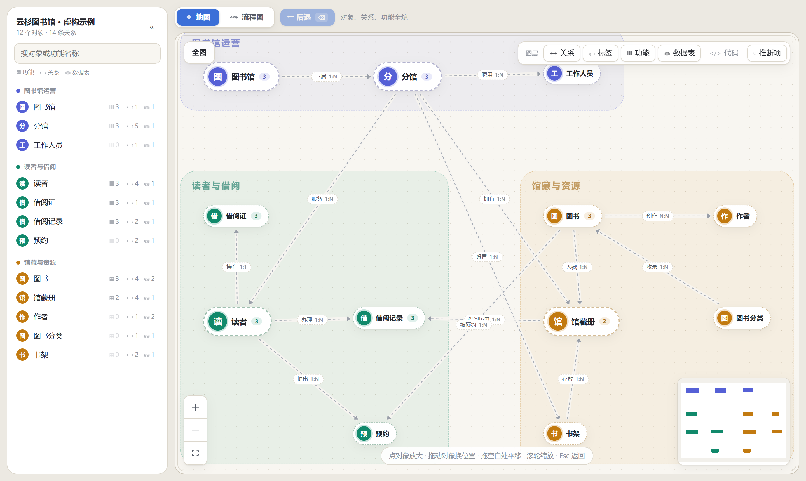
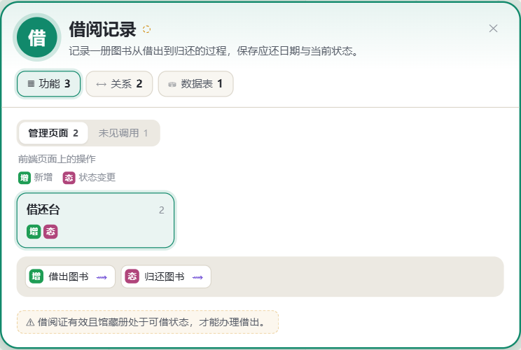
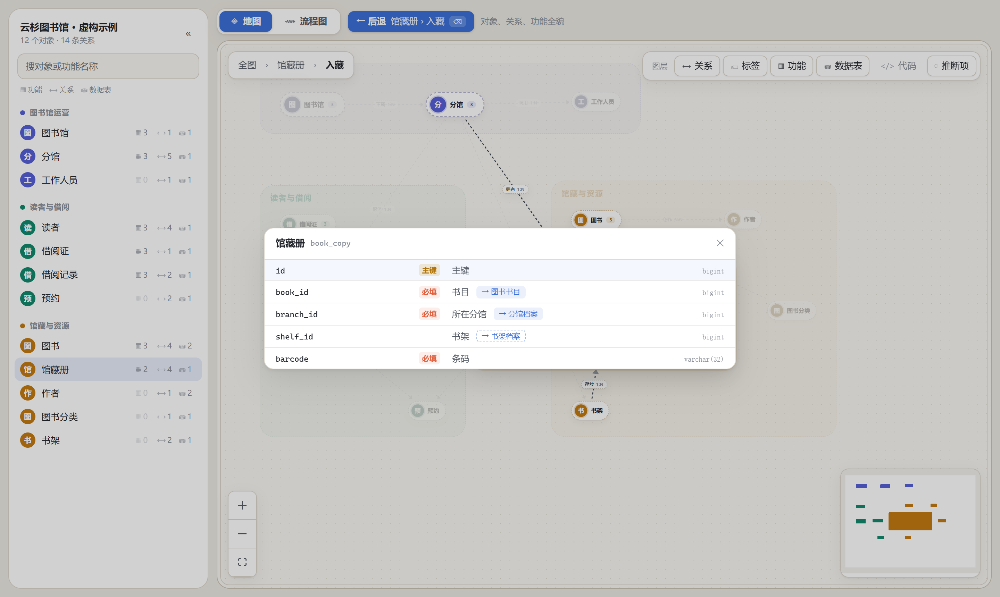
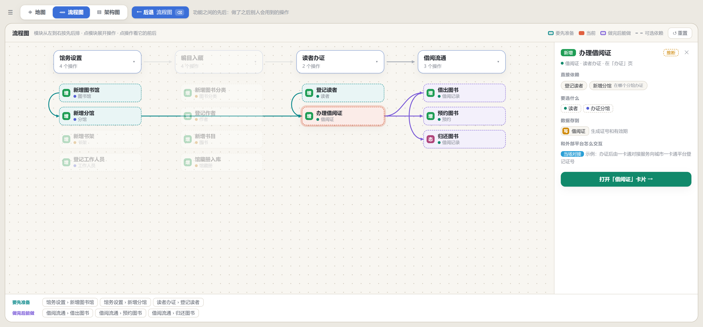

# BizAtlas

**给业务系统画一张「业务地图」**：系统里有哪些业务对象、各自负责什么、相互怎么关联，一眼看清；再往下点，能看到每个对象有哪些功能、存在哪些表里、表之间谁依赖谁、操作要按什么先后来做，每一条都能追到源码里的出处。

适合这些场景：

- 新人接手一个陌生的业务系统，想先弄懂业务全貌，而不是从几百张表、几千个接口里硬啃。
- 产品、测试、实施想知道「做 B 之前必须先有 A」「这个字段到底从哪来」，又不想翻代码。
- 开发要改一个对象，想先看清它的上下游会牵连到谁。

地图数据由 AI 读源码整理出来（仓库附带现成的 [skill](#用-ai-生成你自己项目的地图)），查看器只负责展示，不扫描源码、不连接数据库。



<sub>截图均来自仓库自带的虚构「图书馆」示例。</sub>

## 一句话开始

在你的业务项目里打开 AI 编码代理（Claude Code、Codex 等），把这句话发给它：

```text
按 https://github.com/yixide/BizAtlas 的 INSTALL.md 安装 BizAtlas，然后给这个项目画业务地图
```

AI 会先问你 BizAtlas 装在哪（默认装在用户主目录下），自己下载、安装好 BizAtlas 和配套 skill，再问你要整理哪些模块、地图放在哪里，整理完给你一个本地地址打开看。换个项目再说一次同样的话，它会用已装好的那份，把新项目登记进同一个查看器。

不想用了，同样一句话卸载：

```text
按 https://github.com/yixide/BizAtlas 的 INSTALL.md 卸载 BizAtlas
```

AI 会先列出要删的东西请你确认：只留在本机的地图会问你要不要备份，放在项目里的地图默认保留。

> AI 代理请直接阅读 [INSTALL.md](INSTALL.md)。

## 能看什么

**业务地图**

- 按领域分区排布业务对象，实线是有代码证据的关系，虚线是推断；可搜索、定位，主干关系突出，次要关系弱化。
- 点开对象是一张放大卡片：
  - **功能**：按分组列出这个对象的所有操作，按管理页面、快速接口、外部对接、未见调用分类，带接口和代码位置。
  - **关系**：和哪些对象有关、什么关系、一对一还是一对多。
  - **数据表**：分「上游 / 本对象 / 下游」三行，只显示直接依赖；点表弹窗看完整字段，主键、必填、引用一目了然，可顺着引用跳到别的表、跳到所属对象，并逐级返回。
  - **代码**：证据所在的文件和行号。
- 已经懂了的领域或对象可以「收起」（地图上点领域地块右上角的按钮、对象悬停时右上角的 ✕、放大卡片上的「从地图收起」，或在左侧列表里点），从地图上拿掉，相关连线一起隐去；列表里留着淡色，随时放回，下次打开还记得。
- 连了很多对象的枢纽（如平台、机构）带关系数角标，全图下它和别的领域的关系按领域合成一条带数量的粗线，悬停或放大它时再拆成逐条；线多时全图只给高亮的线显示标签。
- 浏览路径可后退，浅色 / 深色主题跟随系统。

<p>
  
  
</p>



**流程图**

- 以「操作」为节点，连线是先后依赖：做这一步之前要先完成哪些步骤，可选依赖用虚线。
- 选中一步，高亮它全部的前置和后续，显示要先选什么、数据写到哪里、和外部平台怎么交互。



**问 AI**（可选）

- 在页面上选中一段文字，或右键点某个按钮，弹出「问 AI」；查看器把选中内容和当前所在位置交给本机的 [Codex CLI](https://github.com/openai/codex)，让它以只读方式查源码，回答这个词在代码里的真实出处和含义，并给出文件和行号。
- 只在本机开发服务器里可用，需要配置源码目录，见下文。

## 快速开始

需要 Node.js 22.12+（或 24+）。

```bash
npm install
```

```bash
npm run dev:example
```

打开终端里打印的地址（默认 http://127.0.0.1:5173）。示例是一套完全虚构的图书馆系统，涵盖全部功能，可以先用它熟悉界面。

## 用 AI 生成你自己项目的地图

仓库的 [`skills/bizatlas/`](skills/bizatlas/SKILL.md) 是一份写给 AI 编码代理的操作手册，教它读你的源码，一步步整理出地图数据，并自己校验。用了上面的[一句话开始](#一句话开始)，AI 已经装好了，下面是手动安装的做法。

### 安装 skill

**Claude Code**：把整个目录复制到个人或项目的 skills 目录。

```bash
cp -r skills/bizatlas ~/.claude/skills/
```

（只想在某个项目里用，就复制到那个项目的 `.claude/skills/` 下。）

**Codex 或其他支持 `SKILL.md` 的代理**：复制到它的 skills 目录。不支持 skill 的工具，直接把 `SKILL.md` 的内容当作提示词交给它即可。

### 让 AI 开始整理

在**你的业务项目**里打开 AI 代理，说：

> 用 bizatlas skill 给这个项目画业务地图，先做订单和库存两个领域，BizAtlas 仓库在 D:/tools/BizAtlas

AI 会依次完成：

1. 确认源码范围：还有没有别的仓库、先做哪些模块（AI 会先扫一遍列给你挑）；再确认地图放在哪：默认放在 BizAtlas 的 `.local/` 下，只留在本机；你同意的话也可以放进项目的 `.bizatlas/`，跟着代码提交给团队。
2. 整理领域、业务对象、表目录、对象关系和主要业务流程，写入 `map.json` 并校验。
3. 补充功能清单 `functions.json`、表字段 `tables.json`、操作先后 `process.json`。
4. 把项目登记到 BizAtlas，打开查看器，汇报覆盖了多少内容、哪些是推断、哪些需要人工核对。

建议先挑一两个核心领域出第一版，看过觉得对路再扩展。代码有变动时，对 AI 说「更新业务地图」，它会核对证据并补齐新增的内容。

### 多个项目

BizAtlas 在本机只装一份，所有项目共用。每个项目的地图登记在 BizAtlas 根目录的 `.local/projects.json`（`.local/` 已被 Git 忽略），AI 整理完会自己登记：

```json
{
  "projects": [
    { "id": "my-app", "name": "我的应用", "dataDir": ".local/my-app/.bizatlas", "sourceDir": "D:/work/my-app" },
    { "id": "shop", "name": "商城", "dataDir": "D:/work/shop/.bizatlas",
      "sources": { "shop": "D:/work/shop", "gateway": "D:/work/shop-gateway" } }
  ]
}
```

`dataDir` 可以在 BizAtlas 的 `.local/` 下，也可以在项目自己的仓库里；源码目录可选，配了才能使用「问 AI」。

**一个系统分在多个仓库里**（比如主系统和独立运行的对接服务共用一个数据库）：画在同一张地图上，用 `sources` 登记每个仓库，第一个是主仓库。地图里来自其他仓库的代码位置显示为 `gateway:src/x.cs:18`，「问 AI」会在这些仓库里一起查。以后想加仓库，在那个仓库里对 AI 说「把这个仓库加进 shop 的业务地图」即可。示例里的「一卡通回调」和「办理借阅证」演示了这种写法。

### 打开你的地图

在 BizAtlas 目录下：

```bash
npm run dev
```

页面左上角下拉切换项目，下次打开默认是上次看的那个。想直接打开某个项目：

```bash
npm run dev -- --project my-app
```

没登记的目录也可以临时打开：

```bash
npm run dev -- --data D:/work/my-app/.bizatlas --source D:/work/my-app
```

修改数据文件后页面会自动刷新。

## 数据文件

```text
.bizatlas/
├── map.json         # 必需：领域、对象、关系、表目录
├── functions.json   # 可选：每个对象有哪些功能
├── tables.json      # 可选：表字段与字段间引用
└── process.json     # 可选：操作之间的先后，供「流程图」视图
```

字段说明见 [数据格式](docs/data-format.md)，`map.json` 的结构约束见 [JSON Schema](schema/map.schema.json)。可选文件缺失时，对应界面不显示或只显示基础信息。

关于可信度：每条信息都标注「已确认」或「推断」。「已确认」表示代码或建表定义支持它，必须附带源码证据；它**不代表**数据库现场核对或线上运行验证。AI 归纳出的业务作用、流程顺序默认是推断。

## 「问 AI」的配置

1. 安装并登录 [Codex CLI](https://github.com/openai/codex)，确保命令行里能直接运行 `codex`。
2. 在 `.local/projects.json` 里给项目配 `sourceDir` 或多仓库的 `sources`，或启动时用 `--source` 指定源码目录。

没配置源码目录时，页面上不会出现「问 AI」。Codex 以只读沙箱运行，不会修改你的代码；它的耗时和费用由你自己的 Codex 账号承担。

## 安全与隐私

- 开发服务器只监听 `127.0.0.1`，并禁止通过浏览器直接读取 `.local/`、`.git/` 和 `.env` 文件。
- 加载私有地图时，该地图内容能在这个本地页面里看到，**不要把开发端口公开转发出去**。
- `npm run build` 默认只打包公开示例；如果设置了私有的 `ATLAS_DATA_DIR` 再构建，产物会包含那份地图，发布前请确认。
- 不要把真实项目的地图、源码片段或密钥放进 `examples/`。

## 开发与校验

```bash
npm run validate -- path/to/.bizatlas
```

```bash
npm run typecheck
```

```bash
npm run build
```

`validate` 检查 Schema、ID 唯一、对象与表的引用、流程覆盖、已确认信息必须带证据；不打开源文件，也不保证行号仍然准确。通过后还会给出「质量提示」：关系过多、某个对象连线过多、标签是空话、领域过大这类不影响加载但会让地图难看的问题。`npm run check:data` 验证校验器能拒绝各类坏数据。

可选的浏览器冒烟测试（先启动对应地图，会自动使用已安装的 Edge / Chrome，没有时先 `npx playwright install chromium`）：

```bash
node scripts/smoke.mjs path/to/.bizatlas
```

界面改动后重新生成 README 截图（先 `npm run dev:example`）：

```bash
node scripts/screenshots.mjs
```

技术栈：Vue 3、TypeScript、Vite、Vue Flow。

## 目录

```text
src/map/        业务地图与流程图
scripts/        启动、校验、问 AI 服务
schema/         map.json 的 JSON Schema
docs/           数据格式、产品需求与用户痛点
skills/         给 AI 代理用的地图整理 skill
examples/       虚构的图书馆示例数据
```

## 许可证

[MIT](LICENSE)：可自由使用、修改和分发（包括商业用途），保留版权声明即可。
